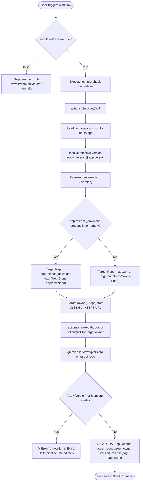

# Business Logic Model - Unit 1: uow-preflight-resolver

## 1. Process Flow Diagram

## 2. Key Data Transformations
1. **App Registry Lookup**: Given `inputs.app = "web-clone"`, locate JSON object in `fastlane/apps.json`.
2. **Version Resolution**:
   - If `inputs.version != ""`: use `inputs.version.trim()`.
   - Else: use `app.version` (fallback `"1.0.0"`).
3. **Repository Slug Normalization**:
   - Matches both `git@github.com:owner/repo.git` and `https://github.com/owner/repo.git`.
   - Normalizes to canonical format: `owner/repo`.
4. **Tag Normalization**: Prefix canonical tag `v${version}`.
