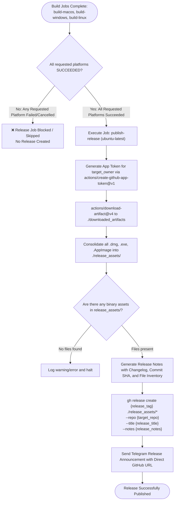

# Business Logic Model - Unit 2: uow-release-publisher

## 1. Process Flow Diagram

## 2. Key Data Transformations
1. **Artifact Aggregation**: Multi-runner directories flattened into `./release_assets/` containing:
   - macOS: `*.dmg`
   - Windows: `*.exe`
   - Linux: `*.AppImage`
2. **Release Title Formulation**:
   `${APP_NAME} v${VERSION}` (e.g. `Web Clone - Multi-Session Browser v1.0.3`).
3. **Release Notes Formulation**:
   Auto-formatted markdown listing commit SHA, trigger actor, build run link, and asset list with file sizes.
