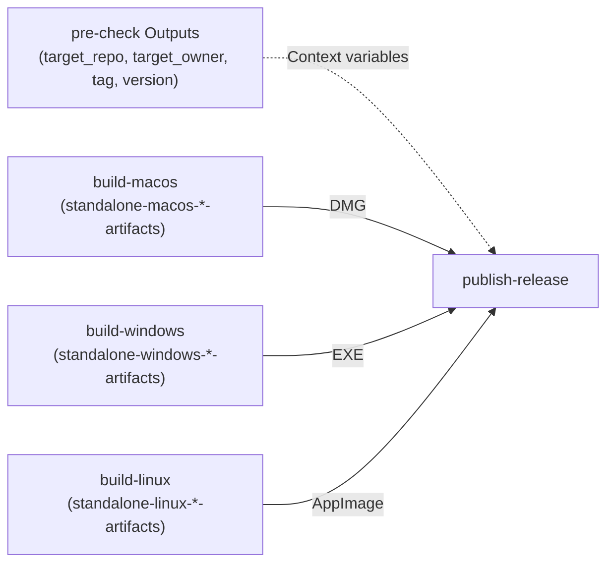

# Component Dependencies & Communication Patterns

## 1. Job Dependency Matrix

| Downstream Job | Depends On (`needs`) | Condition Expression |
|---|---|---|
| `pre-check` | None | `inputs.release == true` |
| `build-macos` | `pre-check` (conditional) | `inputs.platform == 'all' \|\| inputs.platform == 'macos'` |
| `build-windows` | `pre-check` (conditional) | `inputs.platform == 'all' \|\| inputs.platform == 'windows'` |
| `build-linux` | `pre-check` (conditional) | `inputs.platform == 'all' \|\| inputs.platform == 'linux'` |
| `publish-release` | `[pre-check, build-macos, build-windows, build-linux]` | See Gating Logic Below |

## 2. Gating Logic Specification
```yaml
publish-release:
  name: Publish Standalone GitHub Release
  needs: [pre-check, build-macos, build-windows, build-linux]
  if: |
    always() &&
    inputs.release == true &&
    (needs.pre-check.result == 'success') &&
    (inputs.platform != 'all' || (needs.build-macos.result == 'success' && needs.build-windows.result == 'success' && needs.build-linux.result == 'success')) &&
    (inputs.platform != 'macos' || needs.build-macos.result == 'success') &&
    (inputs.platform != 'windows' || needs.build-windows.result == 'success') &&
    (inputs.platform != 'linux' || needs.build-linux.result == 'success')
```

## 3. Data & Artifact Communication Flow


