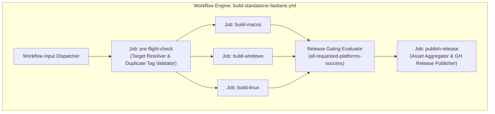

# Component Definitions - Standalone GitHub Release Pipeline

## 1. Component Architecture Overview

## 2. Component Specifications

### 2.1 Workflow Input Dispatcher
- **ID**: `CMP-INPUT-DISPATCHER`
- **Location**: `.github/workflows/build-standalone-fastlane.yml` (root `on.workflow_dispatch`)
- **Responsibilities**:
  - Expose `release` boolean input (default: `false`).
  - Preserve all existing inputs (`app`, `platform`, `version`, `build_number`, `skip_certs`, `notarize`).
  - Pass inputs into job contexts.

### 2.2 Pre-Flight Target Resolver & Release Validator
- **ID**: `CMP-PREFLIGHT-RESOLVER`
- **Location**: `.github/workflows/build-standalone-fastlane.yml` (new job: `pre-check`)
- **Runs-on**: `ubuntu-latest` (fast, lightweight setup < 30 seconds)
- **Condition**: `inputs.release == true`
- **Responsibilities**:
  - Checkout repository to access `fastlane/apps.json`.
  - Resolve effective version (`inputs.version` or `apps.json[app].version`).
  - Resolve target repository: prioritize `release_download` over `git_url`.
  - Parse `owner` and `repo` slug (handle SSH `git@github.com:owner/repo.git` and HTTPS `https://github.com/owner/repo.git`).
  - Generate GitHub App Token for the target repository owner.
  - Query target repository via `gh release view <tag>` for both `v${VERSION}` and `${VERSION}`.
  - Fail pipeline immediately if release tag already exists (Rule 1).
  - Output variables (`target_repo`, `target_owner`, `version`, `release_tag`, `app_name`).

### 2.3 Build Runners (macOS, Windows, Linux)
- **ID**: `CMP-BUILD-RUNNERS`
- **Location**: `build-macos`, `build-windows`, `build-linux`
- **Responsibilities**:
  - Depend on `pre-check` when `inputs.release == true`.
  - Execute existing Fastlane standalone compilation.
  - Export binaries (`.dmg`, `.exe`, `.AppImage`) to GitHub Actions artifacts.

### 2.4 Release Gating Evaluator
- **ID**: `CMP-RELEASE-GATE`
- **Location**: Condition expression on `publish-release`
- **Responsibilities**:
  - Evaluate requested platforms:
    - If `platform == 'all'`: requires `needs.build-macos.result == 'success' && needs.build-windows.result == 'success' && needs.build-linux.result == 'success'`.
    - If `platform == 'macos'`: requires `needs.build-macos.result == 'success'`.
    - If `platform == 'windows'`: requires `needs.build-windows.result == 'success'`.
    - If `platform == 'linux'`: requires `needs.build-linux.result == 'success'`.
  - Block release if any requested job is cancelled or failed (Rule 2).

### 2.5 Release Publisher
- **ID**: `CMP-RELEASE-PUBLISHER`
- **Location**: `.github/workflows/build-standalone-fastlane.yml` (new job: `publish-release`)
- **Runs-on**: `ubuntu-latest`
- **Responsibilities**:
  - Acquire GitHub App Token for target repository owner.
  - Download all uploaded build artifacts using `actions/download-artifact@v4`.
  - Aggregate files into `release_assets/`.
  - Execute `gh release create` with tag, title, auto-generated release notes, and all binaries attached.
  - Post Telegram completion notification with release URL.
