# Context Map - Standalone Release Architecture

## 1. Context Boundaries & Relationships

```mermaid
flowchart LR
    subgraph PreFlightContext["Upstream: Pre-Flight & Target Context (Unit 1)"]
        Inputs["Workflow Inputs"]
        Registry["apps.json Registry"]
        TagValidation["Duplicate Tag Check"]
    end

    subgraph BuildContext["Execution Context: Multi-Platform Runners"]
        MacRunner["macOS Runner (.dmg)"]
        WinRunner["Windows Runner (.exe)"]
        LinuxRunner["Linux Runner (.AppImage)"]
    end

    subgraph ReleaseContext["Downstream: Release Publishing Context (Unit 2)"]
        PlatformGate["Barrier Success Gate"]
        AssetAggregator["Artifact Aggregator"]
        GHRelease["GitHub Release Publisher"]
    end

    PreFlightContext -->|Customer-Supplier: Target Repo Slug & Validation Pass| BuildContext
    BuildContext -->|Customer-Supplier: Built Binaries| ReleaseContext
    PreFlightContext -->|Shared Kernel: Metadata & Auth Token| ReleaseContext
```

## 2. Data Ownership Matrix
- **Unit 1 (`uow-preflight-resolver`)**: Owns input validation, repository URL resolution, tag collision detection, and target owner token acquisition.
- **Build Context**: Owns platform-specific compilation, code signing, and temporary artifact storage.
- **Unit 2 (`uow-release-publisher`)**: Owns multi-platform result aggregation, release notes formatting, asset attachment, and release notification.
