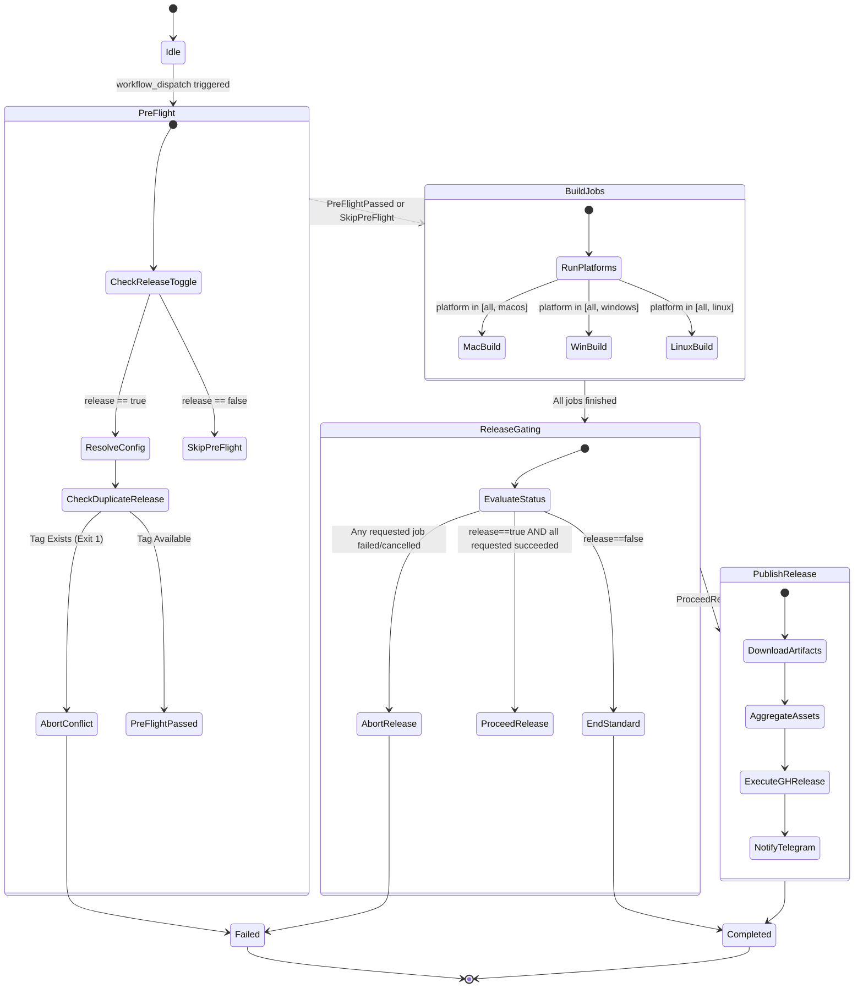

# Service Definitions & Orchestration Patterns

## 1. Service Definitions

### Service 1: Pipeline Pre-Flight Service (`SVC-PREFLIGHT`)
- **Scope**: Target discovery, configuration resolution, authentication exchange, collision detection.
- **Pattern**: Fail-Fast Filter Pattern.
- **Service Contract**:
  - Request: `inputs.app`, `inputs.version`, `inputs.release`.
  - Response (Success): Outputs `target_repo`, `target_owner`, `version`, `release_tag`, `app_name`.
  - Response (Failure): Workflow terminates immediately before build runner initialization.

### Service 2: Multi-Platform Compilation Service (`SVC-COMPILATION`)
- **Scope**: Parallel execution across `build-macos`, `build-windows`, `build-linux`.
- **Pattern**: Scatter-Gather Pattern.
- **Service Contract**:
  - Receives version and app context.
  - Compiles desktop packages and uploads platform artifacts.

### Service 3: Release Orchestration Service (`SVC-RELEASE-ORCHESTRATOR`)
- **Scope**: Multi-job result evaluation, artifact aggregation, release publication.
- **Pattern**: Barrier Synchronization Gate.
- **Service Contract**:
  - Evaluates platform job statuses (`needs.*.result`).
  - Gated execution: Executes only if all requested platform compilation jobs evaluated to `success`.

## 2. Orchestration & State Transition Diagram

