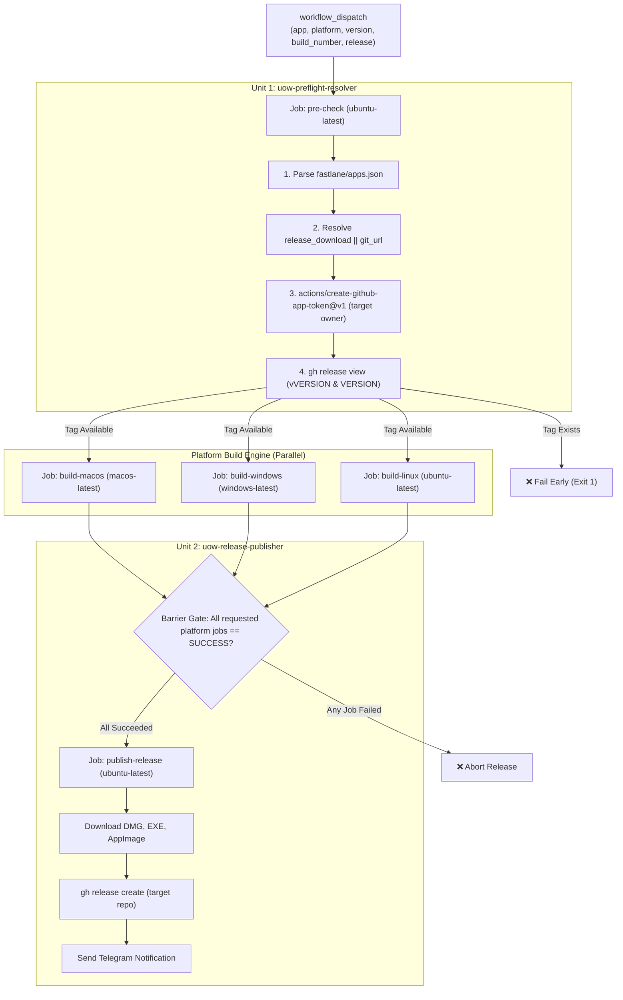

# Detailed Design Baseline: Standalone GitHub Release Automation

## 1. System Context & Overview
This Detailed Design Baseline establishes the definitive architectural specification for adding automated GitHub Release creation and binary asset uploads to `.github/workflows/build-standalone-fastlane.yml` in `thanhlv-fastlane`.



---

## 2. Component Ownership & Unit Decomposition

### 2.1 Unit 1: `uow-preflight-resolver`
- **Component**: `CMP-PREFLIGHT-RESOLVER`
- **Location**: `.github/workflows/build-standalone-fastlane.yml` (`inputs` section and `pre-check` job)
- **Ownership**:
  - `inputs.release`: Boolean input definition.
  - JSON parsing of `fastlane/apps.json`.
  - Target repository resolution (`release_download` priority over `git_url`).
  - Target owner extraction for GitHub App Token generation.
  - Pre-flight duplicate release validation (Rule 1).
  - Emitting job outputs for downstream consumption.

### 2.2 Unit 2: `uow-release-publisher`
- **Component**: `CMP-RELEASE-GATE` & `CMP-RELEASE-PUBLISHER`
- **Location**: `.github/workflows/build-standalone-fastlane.yml` (`publish-release` job and dependencies)
- **Ownership**:
  - Wiring `needs: [pre-check]` into `build-macos`, `build-windows`, `build-linux`.
  - Enforcing all-platforms success barrier gate (Rule 2).
  - Downloading and aggregating all `.dmg`, `.exe`, and `.AppImage` artifacts.
  - Executing `gh release create` to publish the release with attached assets.
  - Dispatching Telegram notifications.

---

## 3. Preliminary API & Data Models

### 3.1 Workflow Input Definition
```yaml
inputs:
  app:
    description: "Chọn App Key trong apps.json (Electron / Desktop)"
    required: true
    default: "web-clone"
    type: choice
    options:
      - "web-clone"
  platform:
    description: "Nền tảng build Standalone ('all' để build đồng thời cả macOS, Windows, Linux)"
    required: true
    default: "all"
    type: choice
    options:
      - "all"
      - "macos"
      - "windows"
      - "linux"
  version:
    description: "Version (Tùy chọn, để trống sẽ lấy từ apps.json / package.json)"
    required: false
    default: ""
    type: string
  build_number:
    description: "Build Number (Tùy chọn, để trống sẽ tự sinh Epoch timestamp)"
    required: false
    default: ""
    type: string
  skip_certs:
    description: "Bỏ qua ký mã nguồn (Skip Code Signing)"
    required: false
    default: false
    type: boolean
  notarize:
    description: "Tự động công chứng Apple Notarization và đóng dấu (Staple) cho macOS DMG"
    required: false
    default: true
    type: boolean
  release:
    description: "Tạo GitHub Release và tải lên các file build thành công"
    required: false
    default: false
    type: boolean
```

### 3.2 Pre-Check Job Outputs Contract
```yaml
outputs:
  target_repo: ${{ steps.resolve.outputs.target_repo }}
  target_owner: ${{ steps.resolve.outputs.target_owner }}
  version: ${{ steps.resolve.outputs.version }}
  release_tag: ${{ steps.resolve.outputs.release_tag }}
  app_name: ${{ steps.resolve.outputs.app_name }}
```

### 3.3 Dynamic Target Resolution Logic (Node.js snippet)
```javascript
const fs = require('fs');
const apps = JSON.parse(fs.readFileSync('fastlane/apps.json', 'utf8'));
const app = apps[process.env.INPUT_APP];
if (!app) {
  console.error(`::error::App '${process.env.INPUT_APP}' không tồn tại trong fastlane/apps.json`);
  process.exit(1);
}

const inputVersion = process.env.INPUT_VERSION || "";
const version = (inputVersion.trim() !== "") ? inputVersion.trim() : (app.version || "1.0.0");
const releaseTag = `v${version}`;

// Ưu tiên release_download nếu có, nếu không thì dùng git_url
const rawUrl = (app.release_download && app.release_download.trim() !== "")
  ? app.release_download.trim()
  : (app.git_url ? app.git_url.trim() : "");

if (!rawUrl) {
  console.error(`::error::Không tìm thấy release_download hoặc git_url cho app '${process.env.INPUT_APP}'`);
  process.exit(1);
}

const match = rawUrl.match(/github\.com[:/]([^/]+)\/([^/.]+)(?:\.git)?$/);
if (!match) {
  console.error(`::error::Không thể parse URL repo GitHub: ${rawUrl}`);
  process.exit(1);
}

const owner = match[1];
const repo = match[2];
const targetRepo = `${owner}/${repo}`;
const appName = app.app_name || process.env.INPUT_APP;

const outputFile = process.env.GITHUB_OUTPUT;
fs.appendFileSync(outputFile, `target_repo=${targetRepo}\n`);
fs.appendFileSync(outputFile, `target_owner=${owner}\n`);
fs.appendFileSync(outputFile, `version=${version}\n`);
fs.appendFileSync(outputFile, `release_tag=${releaseTag}\n`);
fs.appendFileSync(outputFile, `app_name=${appName}\n`);
```

### 3.4 Duplicate Tag Validation Logic (Bash & GitHub CLI)
```bash
export GH_TOKEN="${{ steps.app_token.outputs.token }}"
TARGET_REPO="${{ steps.resolve.outputs.target_repo }}"
RELEASE_TAG="${{ steps.resolve.outputs.release_tag }}"
VERSION="${{ steps.resolve.outputs.version }}"

echo "🔍 Kiểm tra xem release version $VERSION (tag: $RELEASE_TAG) đã tồn tại trên repo $TARGET_REPO chưa..."

# Kiểm tra tag dạng vX.Y.Z
if gh release view "$RELEASE_TAG" --repo "$TARGET_REPO" >/dev/null 2>&1; then
  echo "::error::❌ LỖI: Bản release cho version $VERSION (tag: $RELEASE_TAG) đã tồn tại trên repo $TARGET_REPO! Vui lòng nâng version trước khi tạo release mới."
  exit 1
fi

# Kiểm tra tag dạng X.Y.Z (không có v)
if gh release view "$VERSION" --repo "$TARGET_REPO" >/dev/null 2>&1; then
  echo "::error::❌ LỖI: Bản release cho version $VERSION (tag: $VERSION) đã tồn tại trên repo $TARGET_REPO! Vui lòng nâng version trước khi tạo release mới."
  exit 1
fi

echo "✅ Xác thực thành công: Không có bản release nào trùng lặp trên $TARGET_REPO cho version $VERSION."
```

### 3.5 All-Platforms Success Gating Expression (Rule 2)
```yaml
publish-release:
  name: Publish Standalone GitHub Release
  needs: [pre-check, build-macos, build-windows, build-linux]
  if: |
    always() &&
    inputs.release == true &&
    (needs.pre-check.result == 'success') &&
    (inputs.platform != 'all' || (needs.build-macos.result == 'success' && needs.build-windows.result == 'success' && needs.build-linux.result == 'success')) &&
    (inputs.platform != 'macos' || needs.build-macos.result == 'success') &&
    (inputs.platform != 'windows' || needs.build-windows.result == 'success') &&
    (inputs.platform != 'linux' || needs.build-linux.result == 'success')
```

---

## 4. Failure & Recovery Modes
1. **Target Repository Not Accessible**: Scoped token creation or GitHub CLI error reported with clear instructions regarding GitHub App installation permissions.
2. **Duplicate Tag Detected**: Pipeline stops with exit code 1 in `pre-check`. No compilation jobs are run. Zero minutes wasted.
3. **Single Platform Compilation Failure**: When `platform: all` and macOS succeeds but Windows fails, `publish-release` is blocked. No partial release is published.
4. **Artifact Download Failure**: Checked with defensive directory creation; fails gracefully if expected binaries are missing.

---

## 5. Security & Isolation
- **Token Security**: Tokens are generated in-memory with `actions/create-github-app-token@v1` and injected strictly via `env: GH_TOKEN` for `gh` commands. Never printed or persisted.
- **Audit Logging**: All stages and decisions logged in `aidd-docs/<session-id>/audit.md`.

---

## 6. Verification & Test Plan

| Test Case | Trigger Input | Expected Outcome |
|---|---|---|
| **TC-01: Default Run** | `release: false` | Standard parallel build; no pre-check duplicate query, no release published. |
| **TC-02: Duplicate Tag Conflict** | `release: true`, version already on target repo | `pre-check` job aborts immediately with Rule 1 error; build runners do not start. |
| **TC-03: `release_download` Target** | `app: web-clone`, `release: true` | Target resolved to `Web-Clone-app/download`; release published there. |
| **TC-04: Default `git_url` Target** | `app` without `release_download`, `release: true` | Target resolved to app's `git_url`; release published there. |
| **TC-05: Partial Platform Failure** | `platform: all`, `release: true`, 1 job fails | `publish-release` blocked; no release published. |
| **TC-06: Happy Path Multi-Platform** | `platform: all`, `release: true`, all jobs succeed | GitHub Release created on target repo with `.dmg`, `.exe`, `.AppImage` attached. |

---

## 7. Requirements Traceability Matrix (Final RTM)

| Requirement | Story | Unit of Work | FSD Section | Verification Test Case |
|---|---|---|---|---|
| **FR-1**: `release` Input | US-01 | `uow-preflight-resolver` | 5.1 | TC-01, TC-06 |
| **FR-2**: Dynamic Target Resolution | US-03 | `uow-preflight-resolver` | 5.2 | TC-03, TC-04 |
| **FR-3**: Duplicate Tag Check (Rule 1) | US-02 | `uow-preflight-resolver` | 5.3 | TC-02 |
| **FR-4**: Platform Gate (Rule 2) | US-04 | `uow-release-publisher` | 5.3 | TC-05, TC-06 |
| **FR-5**: Asset Aggregation | US-05 | `uow-release-publisher` | 5.2 | TC-06 |
| **FR-6**: GH Release Creation | US-05 | `uow-release-publisher` | 5.2 | TC-06 |
