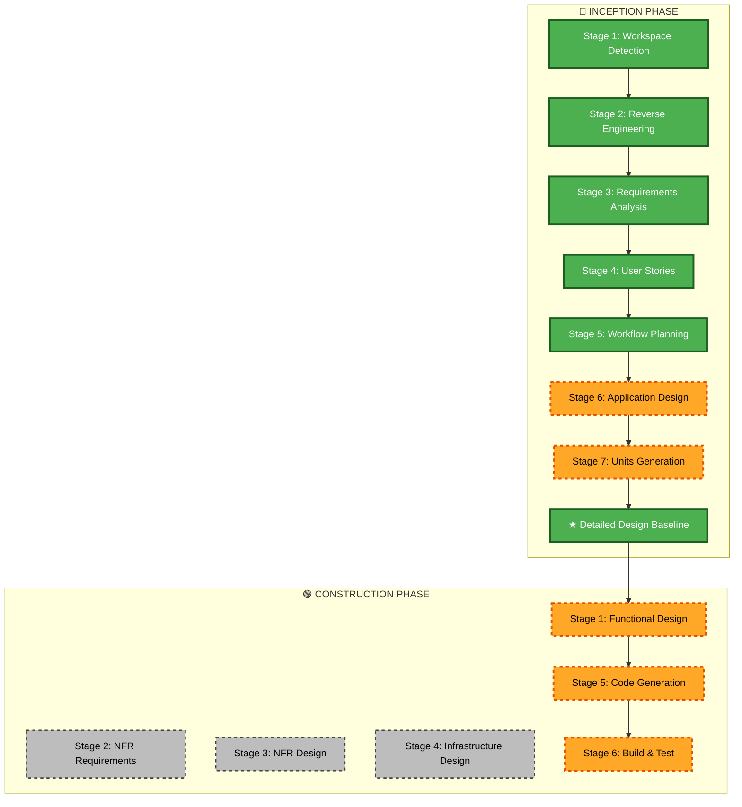

# Execution Plan - Standalone GitHub Release Pipeline

## 1. Detailed Scope & Impact Analysis

### 1.1 Transformation Scope
- **Classification**: Workflow Enhancement / CI-CD Pipeline Extension.
- **Affected Files**:
  - `.github/workflows/build-standalone-fastlane.yml` (Primary target)
  - `fastlane/apps.json` (Contract alignment for `release_download`)
- **Impact by Layer**:
  - **Application / Script Layer**: GitHub Actions step scripts (Node.js/Shell) to parse `apps.json`, resolve `release_download` vs `git_url`, format tags, and interact with `gh release`.
  - **Infrastructure Layer**: GitHub Actions workflow job topology (adding `pre-check` and `publish-release` jobs with dependency links).
  - **Operations Layer**: Telegram notifications for release events, automated release tracking on GitHub.
- **Risk Assessment**: **Low-Medium**. Default `release: false` guarantees zero regressions for existing builds. Strict gating protects against incomplete releases.

---

## 2. Phase & Stage Decisions

### Inception Phase
| Stage | Decision | Rationale |
|---|---|---|
| Stage 1: Workspace Detection | COMPLETED | Brownfield repository detected |
| Stage 2: Reverse Engineering | COMPLETED | Workflows and Fastlane architecture mapped |
| Stage 3: Requirements Analysis | COMPLETED | Requirements and FSD formalized |
| Stage 4: User Stories | COMPLETED | 5 INVEST stories and 10 Gherkin scenarios defined |
| Stage 5: Workflow Planning | IN-PROGRESS | Execution roadmap established |
| Stage 6: Application Design | **EXECUTE** | Component, method, and job interface design required |
| Stage 7: Units Generation | **EXECUTE** | Decompose into 2 clear Units of Work (Pre-Flight Engine & Release Publisher) |
| ★ Detailed Design Baseline | **EXECUTE** | Comprehensive architectural baseline for Construction |

### Construction Phase
| Stage | Decision | Rationale |
|---|---|---|
| Stage 1: Functional Design | **EXECUTE** | Detailed per-unit functional design |
| Stage 2: NFR Requirements | **SKIP** | Standard GitHub runner timeout and rate limits sufficient |
| Stage 3: NFR Design | **SKIP** | No custom NFR infrastructure required |
| Stage 4: Infrastructure Design | **SKIP** | No cloud infrastructure provisioning needed |
| Stage 5: Code Generation | **EXECUTE** | Implement workflow enhancements in YAML and inline scripts |
| Stage 6: Build and Test | **EXECUTE** | YAML validation, syntax checks, and test runner verification |

---

## 3. Workflow Visualization

### Text Alternative
- **Inception Phase**: Stages 1 through 5 completed. Stages 6 (Application Design) and 7 (Units Generation) are executed, culminating in the Detailed Design Baseline.
- **Construction Phase**: Functional Design (Stage 1), Code Generation (Stage 5), and Build & Test (Stage 6) are executed. Stages 2-4 (NFR and Infrastructure) are skipped.

---

## 4. Units of Work Decomposition Overview
- **Unit 1 (`uow-preflight-resolver`)**:
  - Workflow dispatch input `release`.
  - Job `pre-check`: Read `apps.json`, resolve `release_download` vs `git_url`, format tag `v${VERSION}`, check GitHub release existence with fail-fast exit.
  - Job outputs propagation to downstream jobs.
- **Unit 2 (`uow-release-publisher`)**:
  - Gating condition: All requested build jobs (`build-macos`, `build-windows`, `build-linux`) completed with `success`.
  - Job `publish-release`: Multi-OS artifact download, consolidation into `release_assets/`, `gh release create`, and Telegram notification.

---

## 5. Success Criteria & Definition of Done
1. `build-standalone-fastlane.yml` accepts optional `release: boolean`.
2. Existing builds without `release` work with 100% backward compatibility.
3. If `release: true` and the release version already exists on target repo, pipeline fails early with clear error.
4. If `release_download` is present in `apps.json`, release is created on `release_download` repo; otherwise on `git_url` repo.
5. If any requested platform build fails, release job is skipped and no release is published.
6. When all builds succeed, GitHub Release is created with all binaries attached.
