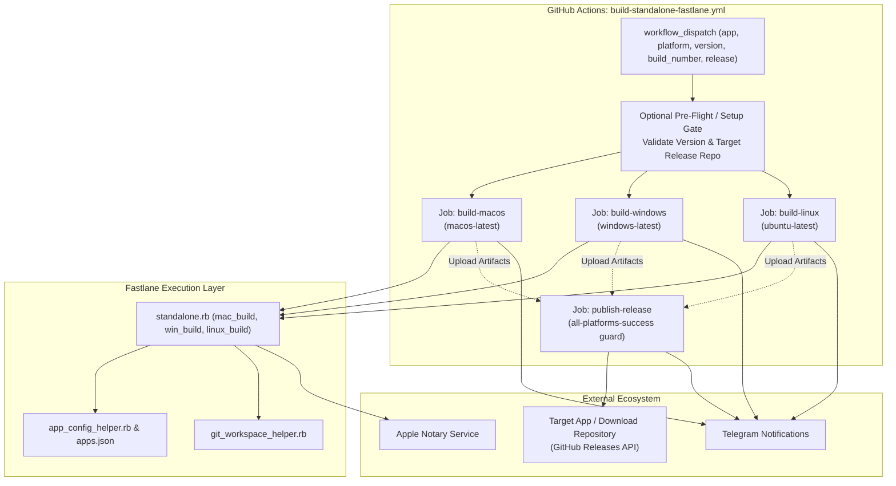
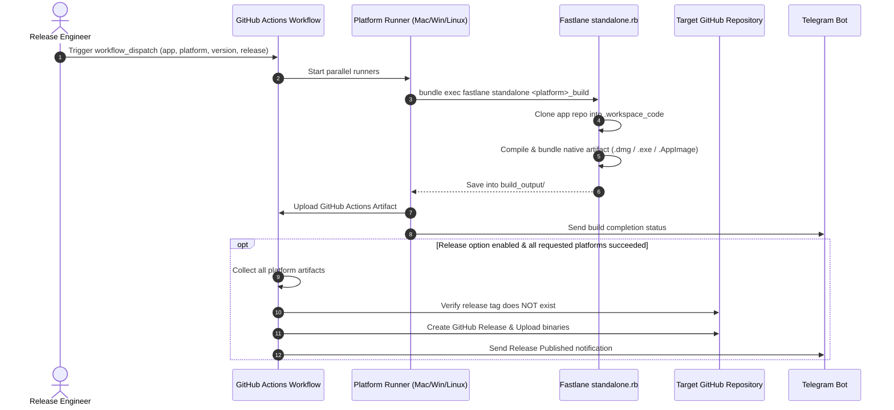

# Architecture Overview - thanhlv-fastlane Standalone Build Pipeline

## 1. System Overview
The `thanhlv-fastlane` architecture separates orchestration (GitHub Actions workflows) from execution (Fastlane lanes and helper modules in Ruby). Standalone builds execute across multi-platform GitHub-hosted runners to produce native desktop binaries.

## 2. Architecture Diagram

### Text Alternative
1. **GitHub Actions Workflow**: Receives user inputs, runs parallel platform jobs, uploads artifacts.
2. **Fastlane Core**: Clones target source repo into `.workspace_code/`, injects version, builds native binary, notarizes if macOS.
3. **External Services**: Apple Developer / Notary APIs, Telegram Bot notifications, GitHub Releases REST/GraphQL endpoints.

## 3. Data & Artifact Flow

## 4. Integration Points
- **GitHub App Authentication**: Uses `actions/create-github-app-token@v1` for scoped access to private keystores, source repositories, and release target repositories.
- **Apple Notary Tool (`xcrun notarytool`)**: Submits DMG/ZIP for gatekeeper notarization.
- **GitHub REST API / CLI (`gh`)**: Verifies release tag presence and creates release assets.
- **Telegram Notification Webhook**: Posts status updates to developer threads.
