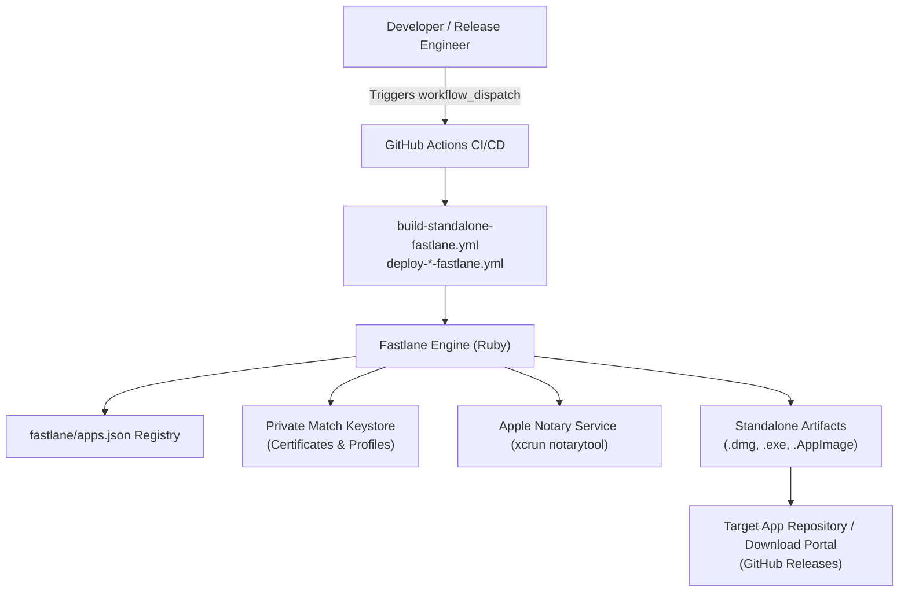

# Business Overview - thanhlv-fastlane Standalone & Multi-Platform CI/CD

## 1. Executive Summary
`thanhlv-fastlane` is a centralized, automated build, code signing, and distribution infrastructure designed for multi-platform applications (macOS, Windows, Linux, iOS, Android). It manages application registries via `fastlane/apps.json`, automates Apple Code Signing & Notarization via Match, orchestrates cross-platform builds via GitHub Actions workflows, and provides a unified entrypoint for both App Store/TestFlight/Play Store publishing and Standalone Desktop distributions.

## 2. Business Context Diagram

### Text Alternative
- **Developer / Release Engineer**: Triggers workflow via GitHub Actions UI with custom parameters.
- **GitHub Actions Workflows**: Executes platform-specific build runners (`macos-latest`, `windows-latest`, `ubuntu-latest`).
- **Fastlane Engine**: Loads `fastlane/apps.json`, resolves signing assets and environment configurations.
- **Apple Notary Service**: Automated notarization and stapling for macOS `.dmg`.
- **Target Repositories**: Source repository (`git_url`) or dedicated download portal repository (`release_download`) for distributing binary releases.

## 3. Core Business Transactions
1. **Application Registration & Metadata Management**: Centralized records of bundle IDs, package names, git URLs, target platforms, and framework definitions.
2. **Apple Developer Identification & Code Signing**: Automated provisioning profile generation, Developer ID Application certificates, and Match synchronization.
3. **Standalone Desktop Packaging**:
   - macOS: DMG assembly, Developer ID signing, xcrun notarytool submission, and ticket stapling.
   - Windows: EXE compilation (NSIS/Inno/Electron Builder).
   - Linux: AppImage bundling.
4. **Distribution & Release Delivery**: Upload of build outputs to GitHub Artifacts and direct GitHub Release publication.

## 4. Business Dictionary
| Term | Definition |
|---|---|
| **App Key** | Unique identifier in `apps.json` representing an application (e.g. `web-clone`). |
| **Standalone Build** | Native desktop distribution bundle (.dmg, .exe, .AppImage) intended for direct user download outside of app stores. |
| **`git_url`** | Git URL of the application's source repository. |
| **`release_download`** | Optional override repository URL specifically dedicated to binary releases and end-user download assets (e.g. `Web-Clone-app/download.git`). |
| **Notarization** | Apple security scanning process ensuring software is free of malicious components before macOS Gatekeeper allows execution. |
| **Match Keystore** | Git-backed, encrypted repository housing Apple certificates and provisioning profiles. |
