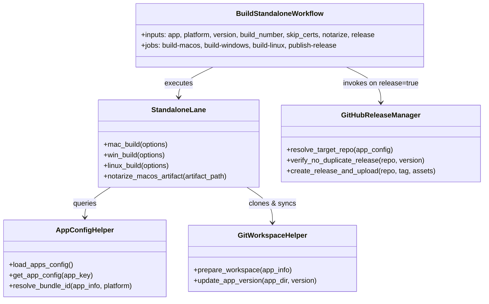

# Code Structure - thanhlv-fastlane Standalone Build System

## 1. Directory & File Inventory

```
thanhlv-fastlane/
├── .github/
│   └── workflows/
│       ├── build-standalone-fastlane.yml  # Main entry point for standalone builds
│       ├── deploy-aos-fastlane.yml        # Android Store deployment
│       ├── deploy-ios-fastlane.yml        # iOS App Store deployment
│       ├── deploy-macos-fastlane.yml      # macOS Mac App Store deployment
│       ├── import-developer-id-fastlane.yml
│       ├── register-apple-fastlane.yml
│       ├── sync-certs-fastlane.yml
│       └── update-metadata-fastlane.yml
├── fastlane/
│   ├── apps.json                          # Central application catalog & metadata
│   ├── Appfile                            # Fastlane app identity configuration
│   ├── Fastfile                           # Lane routing definitions
│   ├── Matchfile                          # Fastlane Match configuration
│   ├── helpers/
│   │   ├── api_key_helper.rb              # ASC API Key parsing
│   │   ├── app_config_helper.rb           # apps.json loader and resolver
│   │   ├── apple_registration_helper.rb   # App & Bundle ID provisioning
│   │   ├── cert_helper.rb                 # Certificate installation & keychain
│   │   ├── git_workspace_helper.rb        # Shallow clone & workspace prep
│   │   ├── google_key_helper.rb           # Play Store service account handler
│   │   └── metadata_helper.rb             # Store listing & metadata sync
│   └── lanes/
│       ├── aos.rb                         # Android build & deploy lanes
│       ├── ios.rb                         # iOS build & deploy lanes
│       ├── macos.rb                       # Mac App Store build lanes
│       ├── standalone.rb                  # Desktop Standalone packaging (DMG, EXE, AppImage)
│       ├── linux.rb
│       └── windows.rb
```

## 2. Key Modules & Class Diagrams



## 3. Design Patterns
- **Workflow Dispatcher Pattern**: Parameterized GitHub Actions workflows orchestrating heterogeneous OS runners.
- **Data-Driven Configuration**: All application definitions and target repositories reside in `fastlane/apps.json`.
- **Pipeline Gatekeeper Pattern**: Release jobs depend on all platform jobs succeeding (`needs: [build-macos, build-windows, build-linux]`).
- **Fail-Fast Pre-Flight Pattern**: Validating target repository release tags prior to running long compilation tasks.
