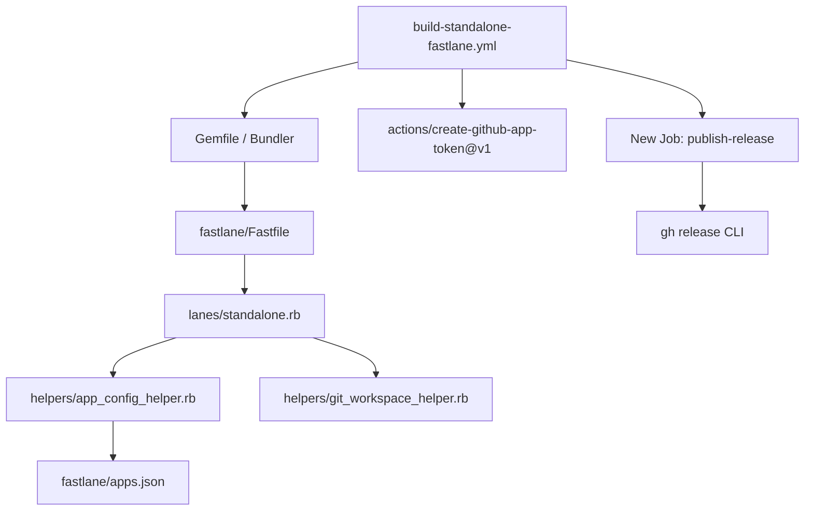

# Dependencies - thanhlv-fastlane

## 1. Internal Dependencies

## 2. External Dependencies & Services
- **GitHub App**: ID `3766151` with private key stored in `THANHLV_PRIVATE_KEY`
- **Keystore Repository**: `apple-certificates-keystore` (private repo accessed via App token)
- **Target Application Repositories**: e.g., `git@github.com:thanhlv-com/web-clone.git`
- **Download / Release Repositories**: e.g., `git@github.com:Web-Clone-app/download.git`
- **Apple Developer & App Store Connect**: Notary API and Developer ID Application certificates
- **Telegram Bot API**: Notifications via `api.telegram.org`
