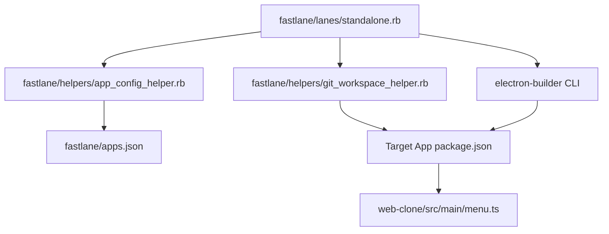

# Component Dependency

## 1. Dependency Graph

## 2. Component Coupling & Communication Analysis

| Source Component | Target Component | Relationship | Interface |
|---|---|---|---|
| `standalone.rb` | `git_workspace_helper.rb` | Direct Ruby Method Call | `configure_electron_version!(dir, ver, build)` |
| `standalone.rb` | `app_config_helper.rb` | Direct Ruby Method Call | `resolve_version_and_build_number(info, opt)` |
| `git_workspace_helper.rb` | `package.json` | File System Read/Write | `File.read`, `File.write`, `JSON.pretty_generate` |
| `standalone.rb` | `electron-builder` | Subshell Process | `run_node_cmd(cmd, dir)` |
| `menu.ts` | Electron Runtime | Internal Method Call | `app.getVersion()` |

## 3. Risk Mitigation
- **Risk**: Missing `package.json` in a non-Electron or corrupted repository.
- **Mitigation**: `configure_electron_version!` checks `File.exist?(package_json_path)` and gracefully returns `false` with a non-fatal warning if absent.
