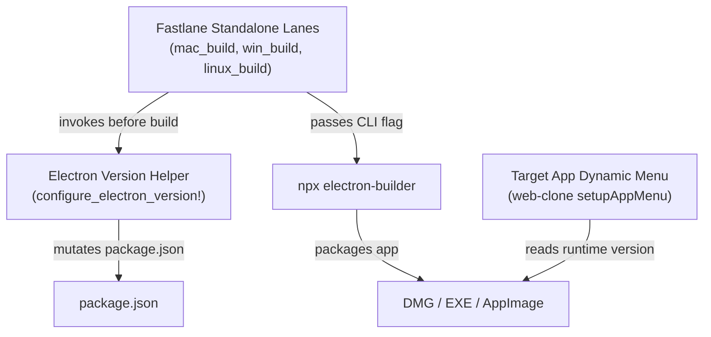

# Application Components

## 1. Component Overview

The version synchronization architecture consists of three collaborating components:

## 2. Component Inventory

### COMP-01: `FastlaneStandaloneLane`
- **Location**: `fastlane/lanes/standalone.rb`
- **Role**: Automation orchestrator for desktop builds.
- **Responsibilities**:
  - Resolves version and build number from command line options or `apps.json`.
  - Determines framework type via `is_electron_app?`.
  - Prepares workspace and calls `configure_electron_version!`.
  - Injects `-c.extraMetadata.version=#{version_name}` into electron-builder execution string.
  - Codesigns and notarizes output packages.

### COMP-02: `ElectronWorkspaceHelper`
- **Location**: `fastlane/helpers/git_workspace_helper.rb`
- **Role**: Workspace manipulation utility.
- **Responsibilities**:
  - Locates `package.json` in target workspace.
  - Parses JSON content safely with error handling.
  - Updates the top-level `"version"` attribute.
  - Writes back formatted, indented JSON.

### COMP-03: `ElectronDynamicMenu`
- **Location**: `.workspace_code/web-clone/src/main/menu.ts`
- **Role**: Target Electron application menu controller.
- **Responsibilities**:
  - Configures the macOS and Windows/Linux application menu.
  - Populates `app.setAboutPanelOptions` dynamically from `app.getVersion()`.
