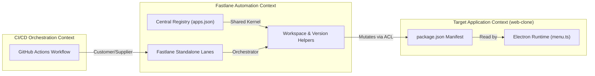

# Context Map

## 1. Bounded Contexts

## 2. Relationship Patterns
- **GitHub Actions -> Fastlane**: Customer-Supplier. GitHub Actions passes inputs (`app`, `platform`, `version`, `build_number`) to Fastlane CLI.
- **Fastlane Helper -> Target App `package.json`**: Upstream-to-Downstream file synchronization. Fastlane ensures target application manifest matches centralized registry declarations before packaging begins.
