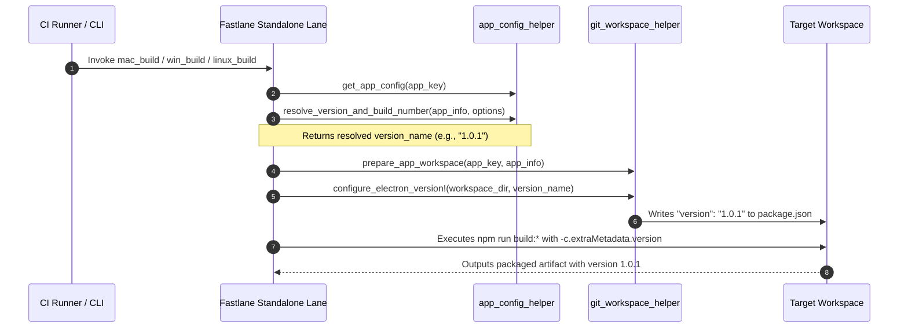

# Services & Orchestration Patterns

## 1. Standalone Build Lifecycle Service

The standalone desktop build process follows a four-phase lifecycle orchestration:

## 2. Orchestration Invariants
1. **Idempotency**: Running the lane repeatedly with the same or modified version always safely overwrites `package.json` without file corruption.
2. **Environment Isolation**: Execution uses `Bundler.with_unbundled_env` via `run_node_cmd` to guarantee that Ruby Gems do not interfere with Node/npm commands.
3. **Dual-Layer Guarantee**:
   - Layer 1: In-file mutation of `package.json` ensures runtime `app.getVersion()` and Vite compilation see the updated version.
   - Layer 2: CLI build flag `-c.extraMetadata.version` ensures `electron-builder` overrides any cached build metadata.
