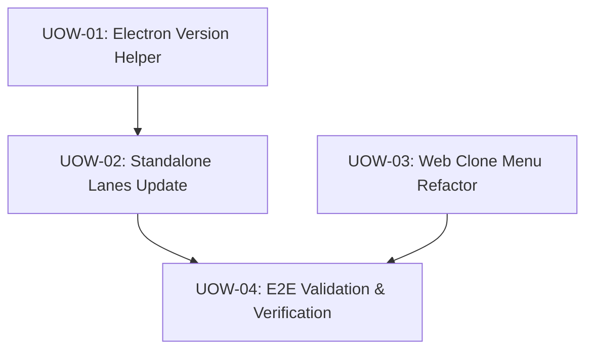

# Unit of Work Dependency

## 1. Dependency Graph

## 2. Execution Order & Parallelism

| Phase | Units | Parallel Execution Allowed? | Preconditions |
|---|---|---|---|
| **Phase 1** | UOW-01 (Helper), UOW-03 (App Menu) | Yes (Independent components) | Inception baseline approved |
| **Phase 2** | UOW-02 (Lanes Update) | No (Depends on UOW-01) | UOW-01 completed |
| **Phase 3** | UOW-04 (E2E Verification) | No (Depends on UOW-02 & UOW-03) | UOW-01, UOW-02, UOW-03 completed |
