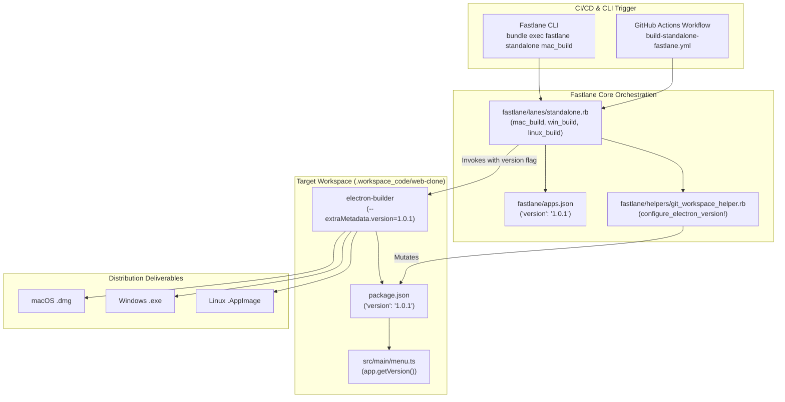

# Detailed Design Baseline

## Document Metadata
- **Project Name**: `thanhlv-fastlane`
- **Session ID**: `2026-10-28-b325e33d`
- **Document Version**: 1.0.0
- **Status**: Official Baseline (Handoff to Construction Phase)
- **Author**: AI-DD Inception Engine
- **Generated Date**: 2026-10-28T15:35:00+07:00

---

## 1. Executive Summary & Problem Scope

### 1.1 Context
In `thanhlv-fastlane`, applications are declared in `fastlane/apps.json`. For the Electron application `web-clone`, `apps.json` defines `"version": "1.0.1"`. However, standalone packaging via `build-standalone-fastlane.yml` or Fastlane lanes (`mac_build`, `win_build`, `linux_build`) produced artifacts with version `1.0.0`.

### 1.2 Root Cause Analysis
1. Fastlane standalone lanes resolved `version_name = "1.0.1"`, but failed to update the target application's `package.json` in `.workspace_code/web-clone/` prior to invoking `electron-builder`.
2. The GitHub Actions workflow `build-standalone-fastlane.yml` did not explicitly propagate the `version` flag when left blank, relying on Fastlane's in-memory resolution which never persisted to disk.
3. Target app `web-clone/src/main/menu.ts` hardcoded `applicationVersion: '1.0.0'` and `version: '1.0.0'` in `app.setAboutPanelOptions`, preventing dynamic reflection of version updates.

---

## 2. System Context & Architecture



---

## 3. Unit of Work Breakdown & Ownership

| Unit ID | Unit Name | Target File | Key Responsibility |
|---|---|---|---|
| **UOW-01** | Electron Version Injection Helper | `fastlane/helpers/git_workspace_helper.rb` | Implements `configure_electron_version!(workspace_dir, version_name, build_number)` to safely update `package.json`. |
| **UOW-02** | Standalone Lanes Integration | `fastlane/lanes/standalone.rb` | Integrates `configure_electron_version!` and `-c.extraMetadata.version=#{version_name}` across `mac_build`, `win_build`, `linux_build`. |
| **UOW-03** | Web Clone Dynamic About Panel | `.workspace_code/web-clone/src/main/menu.ts` | Refactors `setupAppMenu` to dynamically call `app.getVersion()`. |
| **UOW-04** | E2E Verification & Testing | Test suites, `Makefile`, `Fastfile` | Validates Ruby syntax (`ruby -c`), TypeScript compilation (`npm run typecheck`), and end-to-end version packaging. |

---

## 4. Technical Contracts & Method Specifications

### 4.1 `configure_electron_version!` Contract
```ruby
def configure_electron_version!(workspace_dir, version_name, build_number = nil)
  return false if version_name.nil? || version_name.to_s.strip.empty?
  package_json_path = File.join(workspace_dir, "package.json")
  return false unless File.exist?(package_json_path)

  begin
    pkg_data = JSON.parse(File.read(package_json_path))
    old_version = pkg_data["version"]
    pkg_data["version"] = version_name.to_s.strip
    
    File.write(package_json_path, JSON.pretty_generate(pkg_data) + "\n")
    UI.success("📝 Đã cập nhật version: #{old_version} -> #{version_name} trong #{File.basename(package_json_path)}")
    true
  rescue => e
    UI.error("⚠️ Không thể cập nhật version vào package.json: #{e.message}")
    false
  end
end
```

### 4.2 Standalone Build Command Construction
```ruby
version_arg = (version_name && !version_name.empty?) ? " -c.extraMetadata.version=#{version_name}" : ""
build_cmd = if scripts["build:#{platform}"]
              "#{pkg_mgr} run build:#{platform} --#{version_arg}"
            elsif scripts["build"]
              "#{pkg_mgr} run build && npx electron-builder --#{platform}#{version_arg}"
            else
              "npx electron-builder --#{platform}#{version_arg}"
            end
```

### 4.3 Web Clone Menu Contract
```typescript
app.setAboutPanelOptions({
  applicationName: 'Web Clone',
  applicationVersion: app.getVersion(),
  version: app.getVersion(),
  copyright: 'Copyright © 2026 Web Clone. All rights reserved.',
  credits: 'Multi-Session Browser Platform',
  authors: ['Web Clone Team'],
  website: 'https://example.com',
  iconPath
})
```

---

## 5. Failure Handling & Recovery Strategies

| Failure Scenario | Impact | Recovery / Fallback Behavior |
|---|---|---|
| `package.json` missing or corrupt | High | `configure_electron_version!` catches JSON errors, logs detailed warning, and returns `false`. Build command still attempts CLI `-c.extraMetadata.version` parameter injection. |
| Workflow parameter `version` is empty | None | Fastlane automatically falls back to `app_info["version"]` defined in `apps.json` (`1.0.1`). |
| Target app is Flutter desktop | None | Fastlane detects `!is_electron_app?` and preserves native `--build-name=#{version_name}` and `--build-number=#{build_number}` CLI arguments. |

---

## 6. Verification & Test Plan

1. **Ruby Syntax Validation**:
   `ruby -c fastlane/helpers/git_workspace_helper.rb`  
   `ruby -c fastlane/lanes/standalone.rb`  
   `make check-all`
2. **TypeScript Compilation & Code Standards**:
   `npm run typecheck` in `.workspace_code/web-clone/`  
   `npm run check:lines` in `.workspace_code/web-clone/`
3. **Packaging Dry-Run & Manifest Verification**:
   Verify that `package.json` in `.workspace_code/web-clone/` reflects `"version": "1.0.1"`.

---

## 7. Requirements Traceability Matrix (RTM)

| Requirement ID | Story ID | Unit of Work | Target File | Verification Criteria |
|---|---|---|---|---|
| **FR-01** | US-01 | UOW-01 | `fastlane/helpers/git_workspace_helper.rb` | `package.json` contains updated SemVer |
| **FR-02** | US-01 | UOW-02 | `fastlane/lanes/standalone.rb` | `mac_build`, `win_build`, `linux_build` execute with version args |
| **FR-03** | US-02 | UOW-03 | `.workspace_code/web-clone/src/main/menu.ts` | About panel displays `app.getVersion()` |
| **FR-04** | US-01 | UOW-02 / CI | `build-standalone-fastlane.yml` | Workflow fallback & explicit parameter passing |
