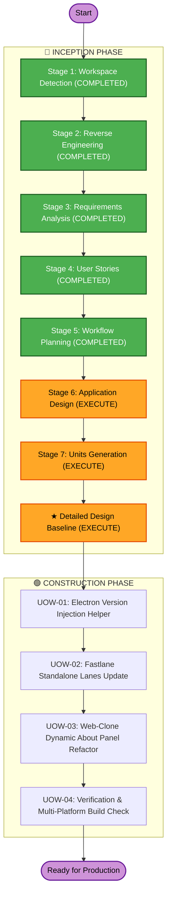

# Execution Plan

## Detailed Analysis Summary

### Transformation Scope (Brownfield)
- **Transformation Type**: Multi-Component Build Pipeline & Application UI Refinement
- **Primary Changes**:
  1. Add `configure_electron_version!(workspace_dir, version_name, build_number)` in `fastlane/helpers/git_workspace_helper.rb`.
  2. Integrate version mutation and electron-builder CLI arguments (`--extraMetadata.version`) into `mac_build`, `win_build`, and `linux_build` in `fastlane/lanes/standalone.rb`.
  3. Refactor `app.setAboutPanelOptions` in `web-clone/src/main/menu.ts` to consume dynamic `app.getVersion()`.
  4. Verify `.github/workflows/build-standalone-fastlane.yml` parameter handling and fallback to `apps.json`.
- **Related Components**: `git_workspace_helper.rb`, `standalone.rb`, `apps.json`, `build-standalone-fastlane.yml`, `web-clone/package.json`, `web-clone/src/main/menu.ts`.

### Change Impact Assessment
- **User-facing changes**: Yes. The packaged application installer name and the runtime About dialog in `web-clone` will accurately show version `1.0.1` (or whichever version is configured/passed).
- **Structural changes**: No. Architecture of Fastlane and Electron remains unchanged.
- **Data model changes**: No schema changes; only updates the JSON key `"version"` in `package.json`.
- **API changes**: No breaking API changes; introduces helper method `configure_electron_version!`.
- **NFR impact**: Negligible execution overhead (<50ms). Preserves complete idempotency across builds.

### Component Relationships
- **Primary Component**: `fastlane/lanes/standalone.rb`
- **Helper Components**: `fastlane/helpers/git_workspace_helper.rb`, `fastlane/helpers/app_config_helper.rb`
- **Configuration Store**: `fastlane/apps.json`
- **Target Application**: `.workspace_code/web-clone/` (`package.json`, `src/main/menu.ts`)
- **CI/CD Pipeline**: `.github/workflows/build-standalone-fastlane.yml`

### Risk Assessment
- **Risk Level**: Low
- **Rollback Complexity**: Easy (Git checkpoint tags and clean file reversion)
- **Testing Complexity**: Moderate (Syntax validation via `ruby -c`, linting in `web-clone`, and standalone packaging dry-runs)

---

## Workflow Visualization

---

## Phases to Execute

### 🔵 INCEPTION PHASE
- [x] Workspace Detection (COMPLETED)
- [x] Reverse Engineering (COMPLETED)
- [x] Requirements Elaboration (COMPLETED)
- [x] User Stories (COMPLETED)
- [x] Workflow Planning (COMPLETED)
- [ ] Application Design - **EXECUTE**
  - **Rationale**: Formulate method contracts for `configure_electron_version!`, lane logic changes in `standalone.rb`, and `menu.ts` refactoring.
- [ ] Units Planning - **EXECUTE**
  - **Rationale**: Plan modular decomposition into discrete Units of Work.
- [ ] Units Generation - **EXECUTE**
  - **Rationale**: Establish UOW specifications and story mappings.
- [ ] Detailed Design Baseline - **EXECUTE**
  - **Rationale**: Finalize comprehensive architectural baseline before Construction.

### 🟢 CONSTRUCTION PHASE
- [ ] Functional Design - **SKIP** (Covered in Inception Baseline & UOW specs)
- [ ] NFR Requirements - **SKIP** (NFRs verified in Requirements Analysis)
- [ ] NFR Design - **SKIP**
- [ ] Infrastructure Design - **SKIP**
- [ ] Code Generation - **EXECUTE** (Implement UOW-01, UOW-02, UOW-03)
- [ ] Build and Test - **EXECUTE** (Syntax checks, unit tests, artifact inspection)
