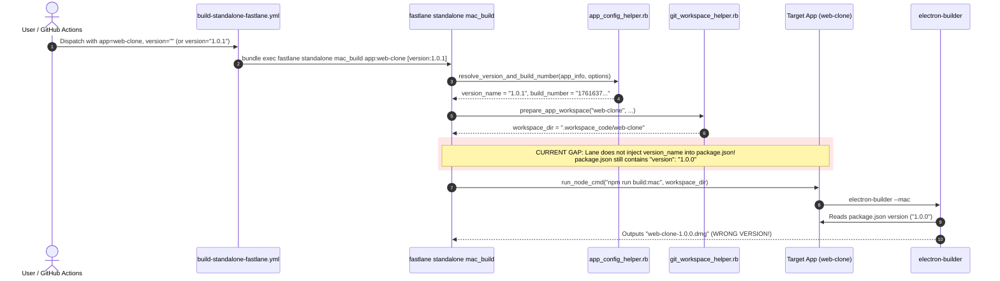

# System Architecture

## System Overview
The `thanhlv-fastlane` architecture is designed as a centralized orchestration layer controlling downstream application codebases. It decouples core pipeline logic (signing, provisioning, packaging, notarization, release automation) from application source code. For standalone desktop builds, Fastlane coordinates between `apps.json` metadata, workflow dispatch parameters, workspace preparation, and framework-specific bundlers (`electron-builder` and `flutter`).

## Architecture Diagram

```mermaid
graph TD
    subgraph "CI/CD & CLI Trigger Layer"
        GHA["GitHub Actions<br/>build-standalone-fastlane.yml"]
        Menu["CLI Interactive Menu<br/>menu.sh / scripts/interactive_menu.rb"]
        Make["Makefile Targets<br/>make build-standalone-*"]
    end

    subgraph "Fastlane Orchestration Core"
        Fastfile["fastlane/Fastfile"]
        StandaloneLane["fastlane/lanes/standalone.rb"]
        ConfigHelper["fastlane/helpers/app_config_helper.rb"]
        WorkspaceHelper["fastlane/helpers/git_workspace_helper.rb"]
        AppsJSON["fastlane/apps.json"]
    end

    subgraph "Target Workspace (.workspace_code/<app_key>)"
        PkgJSON["package.json<br/>(Electron: version, scripts)"]
        BuilderYml["electron-builder.yml<br/>(artifactName: ${name}-${version}.${ext})"]
        AppMenu["src/main/menu.ts<br/>(About dialog options)"]
        FlutterPubspec["pubspec.yaml<br/>(Flutter apps)"]
    end

    subgraph "Build & Distribution Outputs"
        DistMac["dist/*.dmg / .zip"]
        DistWin["dist/*.exe"]
        DistLinux["dist/*.AppImage"]
        Notary["Apple Notary Service<br/>(xcrun notarytool + stapler)"]
    end

    GHA -->|passes app, version, platform| StandaloneLane
    Menu --> StandaloneLane
    Make --> StandaloneLane
    Fastfile --> StandaloneLane

    StandaloneLane --> ConfigHelper
    StandaloneLane --> WorkspaceHelper
    ConfigHelper --> AppsJSON
    WorkspaceHelper -->|Clone/Pull| PkgJSON

    StandaloneLane -->|Build Electron| PkgJSON
    StandaloneLane -->|Build Electron| BuilderYml
    StandaloneLane -->|Build Flutter| FlutterPubspec

    StandaloneLane --> DistMac
    DistMac --> Notary
    StandaloneLane --> DistWin
    StandaloneLane --> DistLinux
```

## Component Descriptions

### `fastlane/lanes/standalone.rb`
- **Purpose**: Implements `mac_build`, `win_build`, and `linux_build` lanes.
- **Responsibilities**:
  - Resolves version name and build number via `resolve_version_and_build_number`.
  - Determines framework (`is_electron_app?`).
  - Prepares signing identities and keychain credentials.
  - Executes build commands (`npm run build:mac`, `build:win`, `build:linux` or `flutter build`).
  - Executes Apple Notarization for DMG outputs on macOS runners.
- **Dependencies**: `app_config_helper.rb`, `git_workspace_helper.rb`, `cert_helper.rb`.
- **Type**: Automation / Orchestration

### `fastlane/helpers/app_config_helper.rb`
- **Purpose**: Centralized accessor for `apps.json`.
- **Responsibilities**:
  - Reads `apps.json`.
  - Resolves application metadata, bundle IDs, and flavor specifications.
  - Resolves `[version_name, build_num]` from option params falling back to `apps.json` values.
- **Dependencies**: `json`, `fastlane_core`.
- **Type**: Utility / Configuration

### `fastlane/helpers/git_workspace_helper.rb`
- **Purpose**: Workspace cloning, directory management, and tool execution wrapper.
- **Responsibilities**:
  - Checks if repo exists in `.workspace_code/` or workspace root.
  - Runs `git fetch`, `git checkout`, `git pull`.
  - Executes npm / flutter commands under isolated environment variables (`run_node_cmd`, `run_flutter_cmd`).
- **Dependencies**: `fileutils`, `open3`.
- **Type**: Infrastructure / Workspace Management

## Data Flow & Version Propagation Flow

## Integration Points
- **Apple Notary Service**: xcrun notarytool submit and stapler staple for macOS DMG distribution.
- **GitHub Actions Runners**: macOS-latest, windows-latest, ubuntu-latest.
- **Telegram Bot Webhook**: Delivers build and status alerts to team chat.
- **Git Repositories**: Clones downstream target apps from GitHub (via GitHub App Token or SSH).
