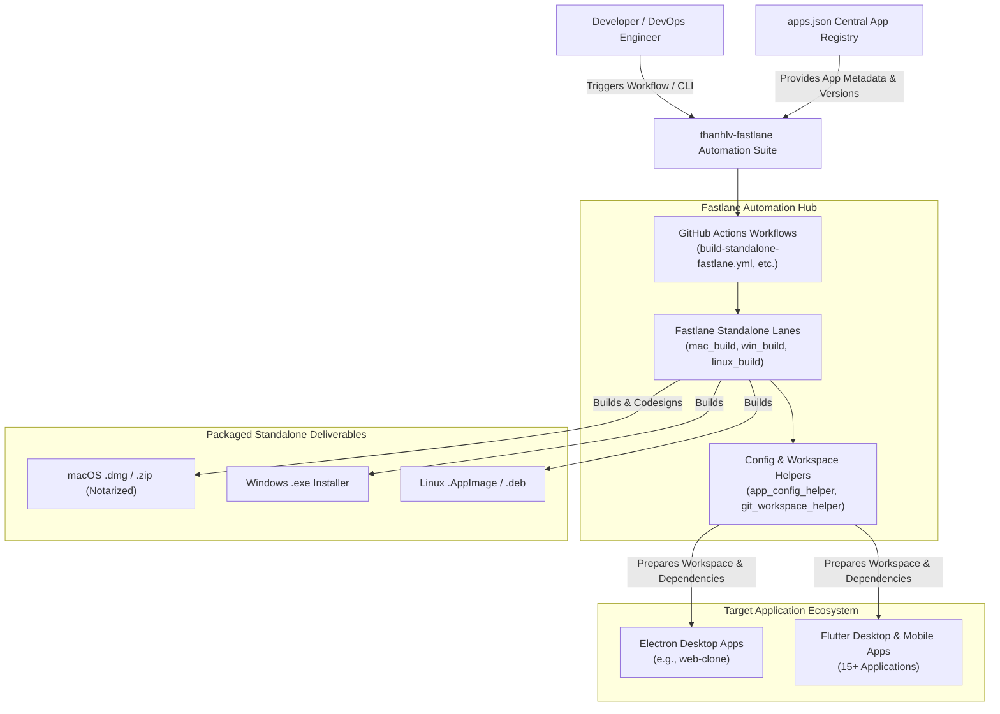

# Business Overview

## Business Context Diagram

## Business Description
- **Business Description**: The `thanhlv-fastlane` repository serves as the centralized multi-platform automation, CI/CD, and release management backbone for an ecosystem of 16+ consumer and developer applications across macOS, iOS, Android, Windows, and Linux. It orchestrates unified versioning, dependency synchronization, Apple Developer Portal and App Store Connect registration, code signing, notarization, compilation, and artifact packaging.
- **Business Transactions**:
  1. **Standalone Desktop Application Packaging**: Automates build, packaging, code signing, and Apple Notarization for desktop applications across macOS, Windows, and Linux from centralized configurations.
  2. **Centralized Version & Build Number Resolution**: Evaluates release versions from manual dispatch parameters (`version`, `build_number`) falling back to `apps.json` declarations (`"version": "1.0.1"`).
  3. **Multi-App Workspace Lifecycle**: Clones or updates target application repositories into `.workspace_code/` without polluting the orchestration repository.
  4. **Multi-Store Release Pipelines**: Automates iOS TestFlight/App Store, Android Google Play (internal/alpha/beta/production), and macOS Developer ID / Mac App Store deliveries.
- **Business Dictionary**:
  - `apps.json`: The single source of truth defining registered application identifiers, repository links, branch references, platforms, obfuscation flags, and baseline versions.
  - `Standalone Build`: Independent desktop application builds (DMG, EXE, AppImage) distributed outside the Mac App Store / Microsoft Store.
  - `Version Propagation / Injection`: The mechanism to take the resolved version string (from workflow params or `apps.json`) and apply it into the target application's configuration (`package.json`, `pubspec.yaml`, runtime about dialogs).

## Component Level Business Descriptions

### `build-standalone-fastlane.yml` (GitHub Actions Workflow)
- **Purpose**: Provides cloud-based matrix execution for standalone desktop builds across macOS, Windows, and Ubuntu runners.
- **Responsibilities**: Receives manual inputs (`app`, `platform`, `version`, `build_number`, `skip_certs`, `notarize`), invokes Fastlane lanes, collects distribution binaries, uploads GitHub artifacts, and reports status via Telegram webhook.

### `fastlane/lanes/standalone.rb` (Fastlane Standalone Suite)
- **Purpose**: Defines automated build routines for desktop standalone distributions (`mac_build`, `win_build`, `linux_build`, `import_developer_id`, `sign_file`).
- **Responsibilities**: Prepares workspaces, resolves semantic version and build numbers, configures signing identities, invokes framework build systems (electron-builder, flutter), and notarizes macOS artifacts via Apple Notarytool.

### `fastlane/helpers/app_config_helper.rb`
- **Purpose**: Parses `apps.json` and extracts platform-specific configuration overrides, bundle IDs, obfuscation flags, and semantic versioning strings.
- **Responsibilities**: Provides `get_app_config`, `resolve_bundle_id`, and `resolve_version_and_build_number`.

### `fastlane/helpers/git_workspace_helper.rb`
- **Purpose**: Manages app workspaces under `.workspace_code/` and provides execution wrappers for Node.js/npm and Flutter commands.
- **Responsibilities**: Clones/pulls repositories, detects framework type (`is_electron_app?`), runs dependency installation (`npm install`, `flutter pub get`), and sanitizes environment variables to prevent Bundler bleeding.

### `web-clone` (Target Electron Application)
- **Purpose**: Multi-session isolated web browser application built with Electron, Vite, TypeScript, and React.
- **Responsibilities**: Provides tabbed browsing with distinct session partitions; packages into macOS DMG, Windows EXE, and Linux AppImage via `electron-builder`. Contains `package.json` and `src/main/menu.ts`.
