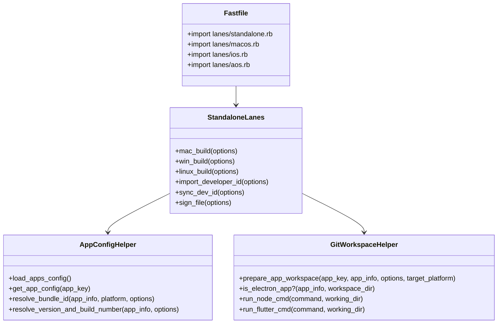

# Code Structure

## Build System
- **Type**: Ruby Bundler / Fastlane with Node.js (Electron) & Flutter SDK sub-toolchains.
- **Key Configuration Files**:
  - `Gemfile`: Fastlane 2.222.0+, Ruby 3.3+.
  - `fastlane/Fastfile`: Main Fastlane entry point importing lane modules.
  - `fastlane/apps.json`: App registry with versions, bundle IDs, and git repositories.
  - `.github/workflows/build-standalone-fastlane.yml`: Matrix build workflow for desktop standalone deliverables.

## Key Modules & Files Inventory

### Existing Files Inventory

- `fastlane/lanes/standalone.rb` - Orchestrates desktop standalone builds across macOS, Windows, and Linux. Currently lacks version injection into Electron `package.json` and CLI parameter overrides.
- `fastlane/helpers/app_config_helper.rb` - Loads `apps.json`, resolves bundle identifiers, and calculates version strings (`resolve_version_and_build_number`).
- `fastlane/helpers/git_workspace_helper.rb` - Clones/pulls app repos, installs npm dependencies, and handles command execution isolation.
- `fastlane/apps.json` - Central JSON database of apps, including `"web-clone": { ..., "version": "1.0.1" }`.
- `.github/workflows/build-standalone-fastlane.yml` - Multi-runner CI/CD workflow executing `mac_build`, `win_build`, and `linux_build`.
- `.workspace_code/web-clone/package.json` - Target app package definition; contains `"version": "1.0.0"`.
- `.workspace_code/web-clone/src/main/menu.ts` - Target app main menu; contains hardcoded `applicationVersion: '1.0.0'`.

## Design Patterns

### Configuration-as-Data Pattern
- **Location**: `fastlane/apps.json`
- **Purpose**: Decouples app metadata, repository URLs, signing settings, and version numbers from build code.
- **Implementation**: Single JSON structure consumed by `app_config_helper.rb` and GitHub Actions matrix generators.

### Environment-Isolated Subshell Execution
- **Location**: `run_node_cmd` and `run_flutter_cmd` in `git_workspace_helper.rb`
- **Purpose**: Avoids Bundler/Ruby environment pollution (`GEM_HOME`, `GEM_PATH`, `BUNDLE_GEMFILE`) when executing Node.js, Electron-Builder, or Flutter binaries.
- **Implementation**: Executes commands via `env -u GEM_HOME ...` inside a `Bundler.with_unbundled_env` block.

## Critical Dependencies

### `fastlane`
- **Version**: `~> 2.222.0`
- **Usage**: Core automation runner and platform integration.
- **Purpose**: Provides cross-platform actions, error reporting, and plugin ecosystem.

### `electron-builder`
- **Version**: `^26.0.12` (in Electron workspaces)
- **Usage**: Packages Node/Vite app into DMG, EXE, and AppImage.
- **Purpose**: Reads `package.json` and `electron-builder.yml` to assemble native desktop bundles.
