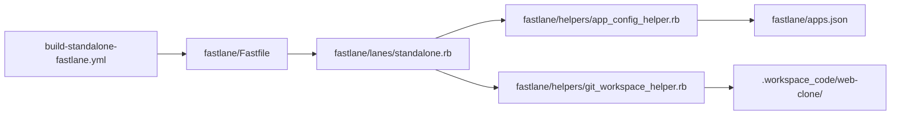

# Dependencies

## Internal Dependencies

### `build-standalone-fastlane.yml` depends on `fastlane/lanes/standalone.rb`
- **Type**: Runtime invocation
- **Reason**: The workflow executes `fastlane standalone mac_build`, `win_build`, or `linux_build` via Bundler.

### `fastlane/lanes/standalone.rb` depends on `app_config_helper.rb`
- **Type**: Ruby helper require
- **Reason**: Needed to resolve app metadata and version details (`get_app_config`, `resolve_version_and_build_number`).

### `fastlane/lanes/standalone.rb` depends on `git_workspace_helper.rb`
- **Type**: Ruby helper require
- **Reason**: Needed to clone target workspaces, detect frameworks (`is_electron_app?`), and execute build subshells.

## External Dependencies

### `fastlane`
- **Version**: `~> 2.222.0`
- **Purpose**: Mobile and multi-platform automation runner.
- **License**: MIT

### `electron-builder`
- **Version**: `^26.0.12`
- **Purpose**: Assembles macOS DMG, Windows NSIS EXE, and Linux AppImage.
- **License**: MIT

### `actions/checkout`, `actions/setup-node`, `actions/upload-artifact`
- **Version**: v4
- **Purpose**: GitHub Actions workflow actions.
- **License**: MIT
