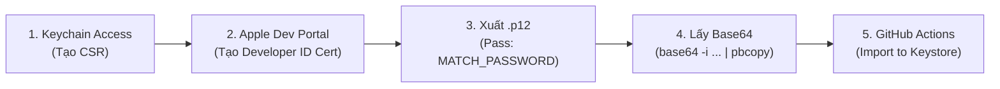

# Hướng Dẫn Tạo & Lưu Chứng Chỉ Developer ID Application Vào apple-certificates-keystore

Tài liệu này hướng dẫn chi tiết quy trình tạo chứng chỉ **Developer ID Application** (dùng để ký ứng dụng macOS Standalone ngoài App Store và Notarize) và lưu trữ mã hóa vào kho lưu trữ chứng chỉ **`apple-certificates-keystore`** thông qua Fastlane Match và GitHub Actions.

---

## 1. Bối cảnh & Nguyên nhân kỹ thuật

Khi chạy lệnh tự động tạo chứng chỉ Developer ID trên CI hoặc qua Fastlane, bạn có thể gặp các lỗi:

```text
➡️  This operation can only be performed by the Account Holder
[!] The request could not be completed because:
    This request is forbidden for security reasons - This operation can only be performed by the Account Holder.
```
hoặc khi chạy `fastlane spaceauth`:
```text
Service key is empty
Could not login to App Store Connect
Spaceship::AppleTimeoutError
```

### Tại sao lại xảy ra lỗi này?
1. **Quy định bảo mật của Apple:** Chứng chỉ `Developer ID Application` cho phép phân phối app macOS tự do trên toàn cầu (vượt qua Gatekeeper). Apple quy định **chỉ DUY NHẤT tài khoản mang vai trò `Account Holder` (Chủ sở hữu Team)** mới có quyền tạo hoặc thu hồi chứng chỉ này.
2. **App Store Connect API Key không có quyền tạo:** Các API Key (kể cả quyền Admin cao nhất) đều bị Apple từ chối cấp quyền tạo `Developer ID Application`.
3. **Apple chặn đăng nhập tự động (`spaceauth` / web cookies):** Apple đã nâng cấp hạ tầng đăng nhập (`idmsa.apple.com`), chặn các luồng cào dữ liệu (scraping) cũ của Fastlane Spaceship và vô hiệu hóa cookie khi phát hiện IP bất thường từ Data Center (GitHub Actions).
4. **Giới hạn số lượng (Hard Limit):** Mỗi tài khoản Apple Developer chỉ được tạo tối đa **5 chứng chỉ `Developer ID Application` trong toàn bộ vòng đời tài khoản**. Do đó, không nên để script tự động cố tạo lại nhiều lần.
5. **Thời hạn chứng chỉ:** Chứng chỉ Developer ID có thời hạn lên tới **5 NĂM** (thay vì 1 năm như chứng chỉ thông thường). Vì vậy bạn **chỉ cần tạo thủ công 1 lần duy nhất trên web Apple**, sau đó lưu vào Keystore để toàn bộ CI/CD dùng chung trong 5 năm.

---

## 2. Quy trình thực hiện chi tiết (Chỉ mất 2 phút)



---

### Bước 1: Tạo Certificate Signing Request (CSR) trên máy Mac
*(Thao tác trên máy Mac cá nhân của Account Holder)*

1. Mở ứng dụng **Keychain Access** (Truy cập chuỗi khóa) trên macOS.
2. Trên thanh menu trên cùng, chọn:  
   **Keychain Access** ➔ **Certificate Assistant** (Trợ lý chứng chỉ) ➔ **Request a Certificate From a Certificate Authority...** (Yêu cầu chứng chỉ từ một tổ chức phát hành chứng chỉ...).
3. Điền thông tin:
   - **User Email Address**: Email tài khoản Apple Developer (Account Holder).
   - **Common Name**: Đặt tên nhận diện, ví dụ: `Developer ID Application - Your Team Name`.
   - **CA Email Address**: Để trống.
   - **Request is**: Tích chọn **Saved to disk** (Đã lưu vào đĩa).
   - Tích chọn: **Let me specify key pair information** (Cho phép tôi chỉ định thông tin cặp khóa).
4. Bấm **Continue** (Tiếp tục) và lưu file ra Desktop với tên:  
   `CertificateSigningRequest.certSigningRequest`.
5. Màn hình tiếp theo chọn:
   - **Key Size**: `2048 bits`
   - **Algorithm**: `RSA`
6. Bấm **Continue** ➔ **Done**.

---

### Bước 2: Tạo chứng chỉ trên Apple Developer Portal

1. Mở trình duyệt web (đã đăng nhập tài khoản Account Holder) và truy cập:  
   👉 [https://developer.apple.com/account/resources/certificates/add](https://developer.apple.com/account/resources/certificates/add)
2. Tại mục **Software**, chọn:  
   🔘 **Developer ID Application** (Dùng cho ứng dụng macOS độc lập / Standalone).
3. Bấm **Continue**.
4. Chọn profile type: **G2 Sub-CA (Xcode 11.4.1 or later)** (mặc định của Apple).
5. Upload file `CertificateSigningRequest.certSigningRequest` đã tạo ở Bước 1.
6. Bấm **Continue** ➔ Bấm **Download** để tải file chứng chỉ về (file thường có tên `developer_id_application.cer`).

---

### Bước 3: Cài đặt vào Keychain và xuất file `.p12`

1. Nhấp đúp vào file `developer_id_application.cer` vừa tải về để cài đặt vào Keychain Access.
2. Trong **Keychain Access** ➔ chọn danh mục **login** ➔ chọn tab **My Certificates** (Chứng chỉ của tôi).
3. Tìm chứng chỉ: `Developer ID Application: <Tên tài khoản/Tổ chức> (<Team ID>)`.  
   *(Bấm vào mũi tên tam giác bên trái để kiểm tra thấy Private Key đi kèm bên dưới)*.
4. Chuột phải vào dòng chứng chỉ đó ➔ Chọn **Export "Developer ID Application: ..."** (Xuất chứng chỉ).
5. Tại mục **File Format**, chọn **Personal Information Exchange (.p12)**.
6. Đặt tên file là `developer_id.p12` và lưu ra Desktop.
7. **QUAN TRỌNG:** Khi hệ thống hỏi mật khẩu bảo vệ file, nhập mật khẩu **trùng với `MATCH_PASSWORD`** của bạn.

---

### Bước 4: Lấy chuỗi mã hóa Base64

Mở Terminal trên máy Mac và chạy lệnh sau để sao chép toàn bộ chuỗi Base64 của file `.p12` vào Clipboard:

```bash
base64 -i ~/Desktop/developer_id.p12 | pbcopy
```

---

### Bước 5: Chạy GitHub Actions để tự động lưu vào Keystore

1. Đảm bảo mã nguồn dự án `thanhlv-fastlane` đã được push lên GitHub:
   ```bash
   git add .
   git commit -m "feat: add import developer id workflow and lane"
   git push origin master
   ```
2. Mở trình duyệt vào GitHub Repository của bạn:
   - Vào tab **Actions**.
   - Ở danh sách bên trái, chọn workflow: **`Import Developer ID Certificate (to Keystore)`**.
   - Bấm **Run workflow** ở góc phải.
3. Dán (`Cmd + V`) chuỗi Base64 đã copy ở Bước 4 vào ô input **`p12_base64`**.
4. Bấm nút xanh **Run workflow**.

---

## 3. Cơ chế xử lý tự động của GitHub Action

Khi workflow chạy, hệ thống sẽ thực hiện hoàn toàn tự động:

1. **Giải mã Base64**: Tạo file tạm thời `/tmp/developer_id_input.p12`.
2. **Trích xuất thông tin qua OpenSSL**:
   - Tách chứng chỉ `.cer` (dạng DER & PEM).
   - Tách Private Key không mật khẩu.
   - Đóng gói lại file `.p12` chuẩn của Match.
3. **Khớp mã định danh với Apple Portal**:
   - Sử dụng App Store Connect API Key để truy vấn danh sách chứng chỉ Developer ID trên Apple Developer Portal.
   - Tìm kiếm Certificate ID khớp chính xác với nội dung file `.cer`.
4. **Mã hóa và Lưu trữ**:
   - Lưu thành `certs/developer_id_application/<CERT_ID>.cer` và `<CERT_ID>.p12`.
   - Mã hóa toàn bộ bằng OpenSSL AES-256 sử dụng `MATCH_PASSWORD`.
   - Commit và Push thẳng vào branch `master` của repository `apple-certificates-keystore` qua GitHub App Token.
5. **Gửi thông báo**: Gửi tin nhắn trạng thái qua Bot Telegram.

---

## 4. Kiểm tra & Sử dụng chứng chỉ sau khi Import

Sau khi workflow chạy thành công:

### 1. Đồng bộ kiểm tra ở máy local (Read-Only)
```bash
fastlane standalone sync_developer_id readonly:true
```
Match sẽ tải chứng chỉ từ Git về, giải mã bằng `MATCH_PASSWORD` và cài vào Keychain máy local mà không cần gọi lệnh tạo mới.

### 2. Sử dụng trong quy trình Build Standalone macOS (CI/CD)
Tất cả các workflow build độc lập macOS (Flutter Desktop hoặc Electron DMG/PKG) trên GitHub Actions sẽ tự động nhận diện và giải mã chứng chỉ này để ký số và gửi công chứng (Notarize) lên Apple:
```bash
fastlane standalone mac_build app:<app_key>
```
Lỗi `This operation can only be performed by the Account Holder` sẽ được loại bỏ vĩnh viễn!
