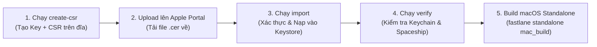

# Hướng Dẫn Quản Lý & Tự Động Hóa Chứng Chỉ Developer ID Application (macOS)

Tài liệu này hướng dẫn chi tiết quy trình tạo, kiểm tra, sửa lỗi, và lưu trữ chứng chỉ **Developer ID Application** (dùng để ký ứng dụng macOS Standalone ngoài App Store và Notarization) vào kho lưu trữ chứng chỉ riêng **`apple-certificates-keystore`** qua Fastlane Match và GitHub Actions.

---

## 1. Bối cảnh & Các quy tắc an toàn kỹ thuật

### Tại sao không thể tạo chứng chỉ tự động 100% qua API?
1. **Quy định bảo mật của Apple:** Chứng chỉ `Developer ID Application` cho phép phân phối app macOS tự do trên toàn cầu (vượt qua Gatekeeper). Apple quy định **chỉ DUY NHẤT tài khoản mang vai trò `Account Holder` (Chủ sở hữu Team)** mới có quyền tạo hoặc thu hồi chứng chỉ này.
2. **App Store Connect API Key không có quyền tạo:** Các API Key (kể cả quyền Admin) đều bị Apple từ chối cấp quyền tạo `Developer ID Application` (`This operation can only be performed by the Account Holder`).
3. **Giới hạn số lượng (Hard Limit):** Mỗi tài khoản Apple Developer chỉ được tạo tối đa **5 chứng chỉ `Developer ID Application`** trong toàn bộ vòng đời tài khoản. Không nên tạo tràn lan hoặc để script tự động thử tạo liên tục.
4. **Thời hạn chứng chỉ:** Chứng chỉ Developer ID có thời hạn lên tới **5 NĂM**. Bạn **chỉ cần tạo 1 lần**, lưu vào Keystore để toàn bộ CI/CD và Local dùng chung trong 5 năm.

---

## 2. Các cạm bẫy thường gặp (Common Pitfalls & Root Causes)

> [!CAUTION]
> Dưới đây là 3 lỗi phổ biến nhất khiến việc ký mã macOS bị thất bại:

| Cạm bẫy / Lỗi | Triệu chứng | Nguyên nhân kỹ thuật & Cách khắc phục |
| :--- | :--- | :--- |
| **1. Export nhầm chứng chỉ S/MIME** | `Code Signing: 0 valid identities found`<br>`(CSSMERR_TP_NOT_TRUSTED)` | Tạo chứng chỉ bằng tính năng "Create a Certificate..." trong Keychain Access. Chứng chỉ này có mục đích `E-mail Protection` (`Code Signing: No`). **Khắc phục:** Phải tạo CSR và tải cert `Developer ID Application` từ Apple Portal (`Code Signing: Yes`). |
| **2. Thiếu Private Key khi Export** | Cert có trong Keychain nhưng không ký được | Cert được tải về nhưng không có Private Key tương ứng trên máy (do CSR được tạo từ máy khác hoặc Private Key đã bị xóa). **Khắc phục:** Tạo CSR mới kèm Private Key lưu trực tiếp ra file bằng OpenSSL. |
| **3. Lỗi `-nomac` trên macOS Sonoma/Sequoia** | `SecKeychainItemImport: Unknown format in import` | macOS Security framework từ chối các file PKCS#12 không có MAC hoặc dùng mã hóa không tương thích. **Khắc phục:** Fastlane Match chuẩn lưu Private Key dưới dạng unencrypted PEM RSA Key trong kho Git mã hóa. |

---

## 3. Quy trình chuẩn bằng Script CLI (Khuyến nghị 100%)

Dự án đã tích hợp công cụ tự động hóa toàn diện tại:
👉 `scripts/manage_developer_id.sh`

### Sơ đồ quy trình:


---

### Bước 1: Tạo Private Key & file CSR (Bằng 1 lệnh)

Chạy lệnh sau trong thư mục dự án:
```bash
./scripts/manage_developer_id.sh create-csr
```
- Lệnh sẽ tạo:
  - Khóa riêng: `.workspace/developer_id/developer_id.key` (được bảo vệ an toàn trên ổ đĩa).
  - File CSR: `.workspace/developer_id/upload_to_apple.certSigningRequest`.

---

### Bước 2: Tải chứng chỉ từ Apple Developer Portal

1. Mở trình duyệt web:  
   👉 [https://developer.apple.com/account/resources/certificates/add](https://developer.apple.com/account/resources/certificates/add)
2. Chọn mục: **Developer ID Application** -> Bấm **Continue**.
3. Bấm **Choose File** -> Chọn file:
   ```
   .workspace/developer_id/upload_to_apple.certSigningRequest
   ```
4. Bấm **Continue** -> Bấm **Download** để tải file `.cer` về máy (ví dụ: `~/Downloads/developerID_application.cer`).

---

### Bước 3: Đóng gói & Nạp vào Keystore tự động

Chạy lệnh import với đường dẫn file `.cer` vừa tải về:
```bash
./scripts/manage_developer_id.sh import ~/Downloads/developerID_application.cer
```
Công cụ sẽ tự động:
1. Kiểm tra Modulus Hash giữa Private Key và Certificate Apple (đảm bảo khớp 100%).
2. Xác thực thuộc tính `Code signing: Yes`.
3. Đóng gói thành `.p12` chuẩn macOS tương thích bảo mật cao.
4. Tự động đồng bộ lên kho Git `apple-certificates-keystore` qua Fastlane Match.
5. Tự động copy chuỗi **Base64** vào Clipboard của bạn để dùng cho GitHub Actions!

---

### Bước 4: Kiểm tra xác thực (Verify)

Kiểm tra toàn bộ hệ thống ký mã bằng lệnh:
```bash
./scripts/manage_developer_id.sh verify
```
Kết quả hiển thị:
- `1 valid identities found`: Nhận diện danh tính Developer ID trong Keychain.
- Danh sách chứng chỉ hợp lệ đang hoạt động trên Apple Developer Portal kèm ngày hết hạn.
- Trạng thái cấu hình Matchfile.

---

## 4. Kiểm tra & Build thực tế

### Build cục bộ (Local macOS):
```bash
fastlane standalone mac_build app:web-clone
```

### Build tự động trên GitHub Actions (CI/CD):
1. Vào tab **Actions** trên GitHub.
2. Chọn workflow: **Build Standalone Desktop Apps (DMG, EXE, AppImage)**.
3. Nhập app cần build (`web-clone`) và bấm **Run workflow**.
4. GitHub Actions sẽ tự động kéo chứng chỉ từ `apple-certificates-keystore`, giải mã và thực hiện ký mã chuẩn Notarization tự động!

---

## 5. Quy trình xoay vòng / Gia hạn chứng chỉ (Sau 5 năm)

Khi chứng chỉ Developer ID Application gần hết hạn (sau 5 năm):
1. Chạy lại Bước 1: `./scripts/manage_developer_id.sh create-csr`.
2. Lên Apple Developer Portal tạo chứng chỉ mới thay thế chứng chỉ cũ.
3. Chạy lại Bước 3: `./scripts/manage_developer_id.sh import ~/Downloads/developerID_application.cer`.
4. Keystore sẽ tự động cập nhật ID mới, toàn bộ quy trình CI/CD sẽ chuyển sang chứng chỉ mới mà không cần sửa đổi bất kỳ dòng mã nào!
